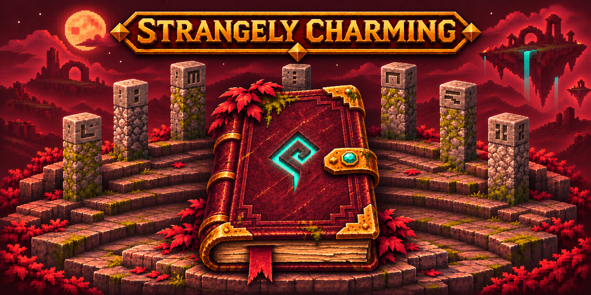
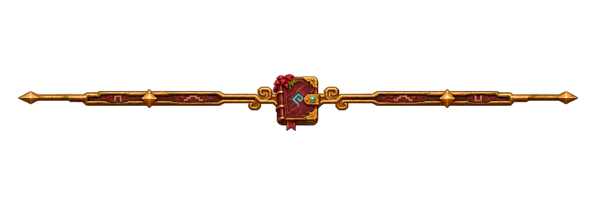
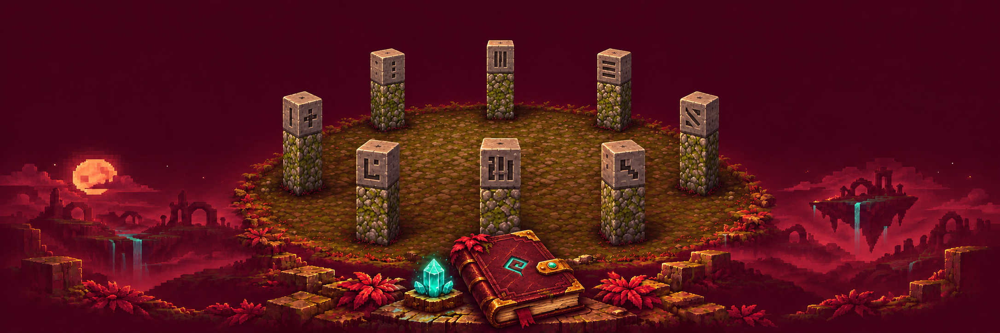

A collection of crafting, exploration and village features for Horizon. Each feature listed below defaults to enabled and can be turned off in `config/strangely_charming.json`. Modpack makers are encouraged to prune features they feel are overpowered or conflict with other mods.

## Crafting and equipment

- **Portable crafting** opens a full crafting grid with **V** while you carry a crafting table.
- **Tidy inventories** merges matching stacks and sorts your backpack or an open storage container with **Y**.
- **Utility recipes** add ways to craft everyday supplies and reclaim materials.
- **Larger stacks** let matching potions, stews and enchanted books stack to 16. Each group has its own switch.
- **Unlimited anvil repairs** let you pay the displayed XP cost even above 39 levels.
- **Enchantment extraction** transfers enchantments from an item onto a plain book at a grindstone for XP.
- **Armor recycling** returns one ingot or gem from fully repaired, unenchanted armor or horse armor.
- **Kilns** use fuel to fire sand, clay and other mineral materials faster.
- **Table Saws and Lumberjacks** turn logs and planks into wooden goods and give villagers a wood-trading profession.
- **Runebreaker** is a handheld diamond hammer crafted from five diamonds and two sticks. Use it to destroy a runestone. The stone takes as long to mine as obsidian and drops nothing.

## Villages and exploration

- **Scrollkeepers** claim Writing Desks and sell local gathering, crafting, mining and hunting quests. Keep two active contracts, check progress with **J**, and sneak-right-click the issuing villager with your completed scroll to collect rewards. Another Scrollkeeper can honor the contract if the issuer dies.
- **Beekeepers** claim beehives and trade bee-related goods.
- **Poison Apples** turn adult, working-age villagers other than nitwits into briefly stunned, daylight-safe zombie villagers while preserving their profession and trades. Brew a potion to unlock the recipe.
- **Moonstones** are sixteen colors of translucent, glowing blocks found in geodes on the outer End islands. Mine them with a pickaxe.
- **Totems of Enchanting** can be found in End city chests. Sneak-use a totem to bank your XP points. Use the filled totem normally to recover the stored points. The same totem can be filled again.
- **Rune circles** mark open Overworld grasslands with eight carved stone pillars.
- **Underground ruins** add branching ice chambers beneath snowy Overworld biomes and buried halls in the Nether.
- **Coral Squids** swim near living coral in warm oceans.
- **Mansion loot** and **Nether fortress loot** add extra treasure to their respective chests.
- **Mineshaft ores** add coal, iron and diamond ore to eligible stone and deepslate floors.
- **Retreat Horns** occasionally drop from player-defeated raid captains. Blow one to end a nearby raid. It recharges in ten minutes.
- **Discovery advancements** introduce the mod’s features as you play.

## Survival and travel

- **Fullbright** toggles client lighting with **G**.
- **Inventory Totems of Undying** protect you from lethal damage while carried in your backpack.
- **Pet protection** prevents accidental melee and direct projectile damage to your own tamed animals.
- **Ender Pearl Blocks** give nearby chorus fruit teleports a destination.
- **Crying obsidian frames** let you use crying obsidian to build working Nether portals.

## Credits

This is an unofficial Horizon port of portions of Charm and Strange, originally created by Sven Hjól. It contains a mix of new and old features that I felt were appropriate for the modern version of minecraft. This mod is brand new and has not had any compatibility tested with other mods. AI assistance was used in the creation of this mod.

Charm: https://github.com/svenhjol/CharmLegacy
Strange: https://github.com/svenhjol/Strange

The following MIT license applies to the portions derived from these projects:

The MIT License (MIT)

Charm: Copyright © 2021 Sven Hjól <sven.hjol@protonmail.com>
Strange: Copyright © 2020 Sven Hjól <sven.hjol@protonmail.com>

Permission is hereby granted, free of charge, to any person obtaining a copy
of this software and associated documentation files (the “Software”), to deal
in the Software without restriction, including without limitation the rights
to use, copy, modify, merge, publish, distribute, sublicense, and/or sell
copies of the Software, and to permit persons to whom the Software is
furnished to do so, subject to the following conditions:

The above copyright notice and this permission notice shall be included in all
copies or substantial portions of the Software.

THE SOFTWARE IS PROVIDED “AS IS”, WITHOUT WARRANTY OF ANY KIND, EXPRESS OR
IMPLIED, INCLUDING BUT NOT LIMITED TO THE WARRANTIES OF MERCHANTABILITY,
FITNESS FOR A PARTICULAR PURPOSE AND NONINFRINGEMENT. IN NO EVENT SHALL THE
AUTHORS OR COPYRIGHT HOLDERS BE LIABLE FOR ANY CLAIM, DAMAGES OR OTHER
LIABILITY, WHETHER IN AN ACTION OF CONTRACT, TORT OR OTHERWISE, ARISING FROM,
OUT OF OR IN CONNECTION WITH THE SOFTWARE OR THE USE OR OTHER DEALINGS IN THE
SOFTWARE.

The Runebreaker uses Malcolm Riley’s unmodified diamond hammer sprite under CC BY 4.0. [Original artwork](https://github.com/malcolmriley/unused-textures/blob/8b85ad732023174d9a9da74e6bf2272d6c0bef17/items/tool_fancy_diamond_hammer.png) · [License](https://creativecommons.org/licenses/by/4.0/) · [Additional credits](mixins/strangely_charming/NOTICE)

